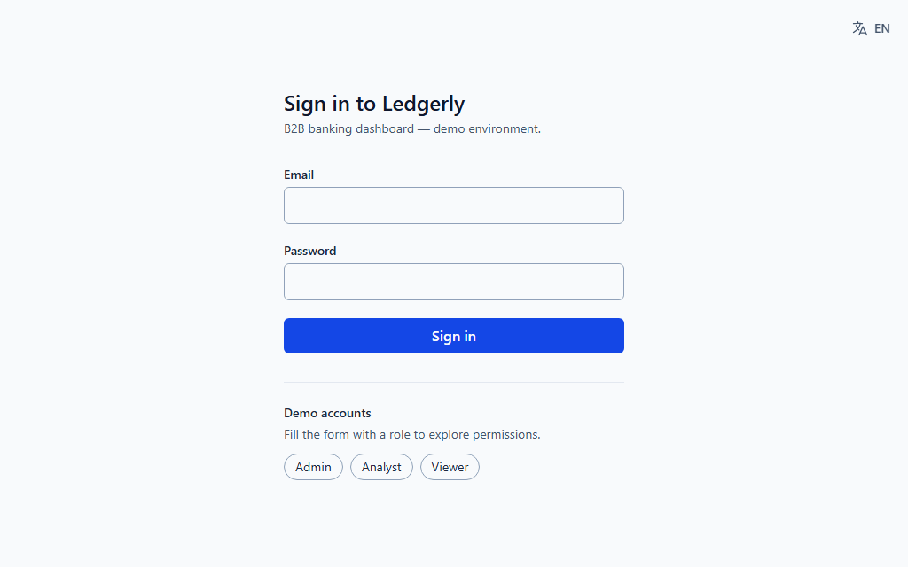
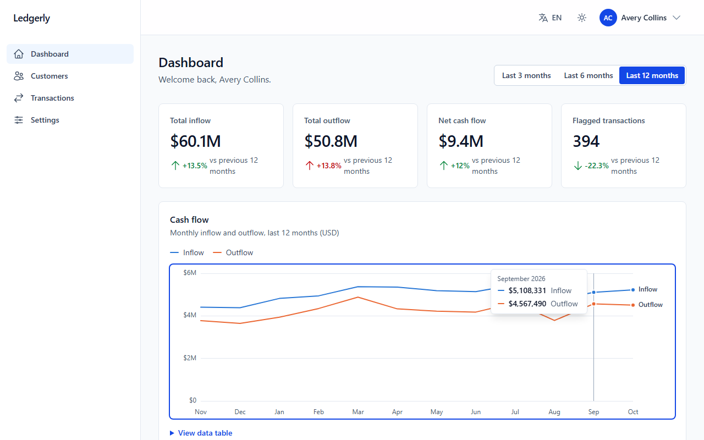
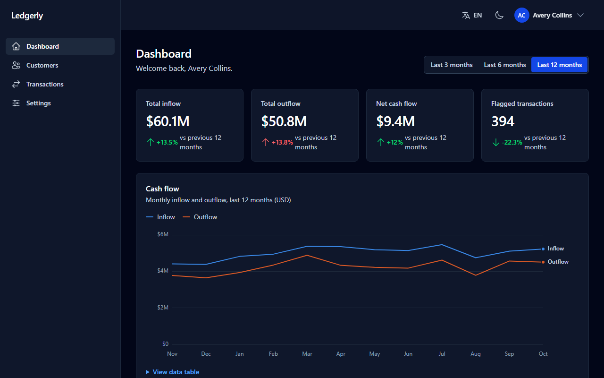
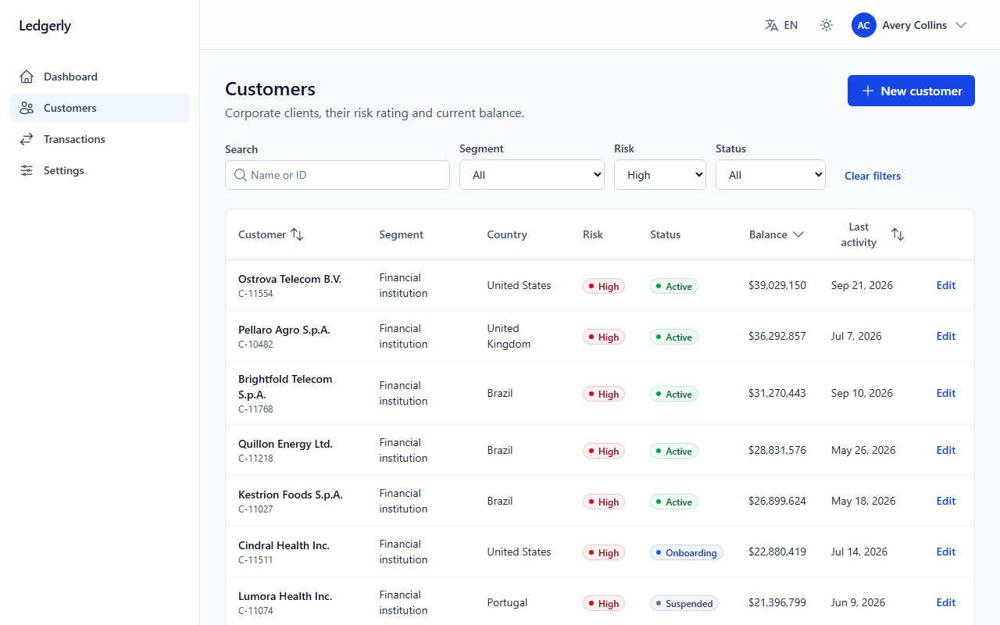
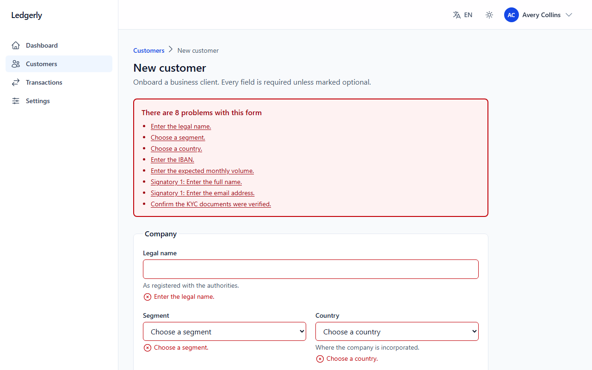
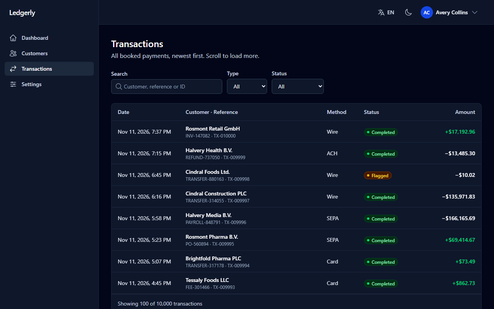
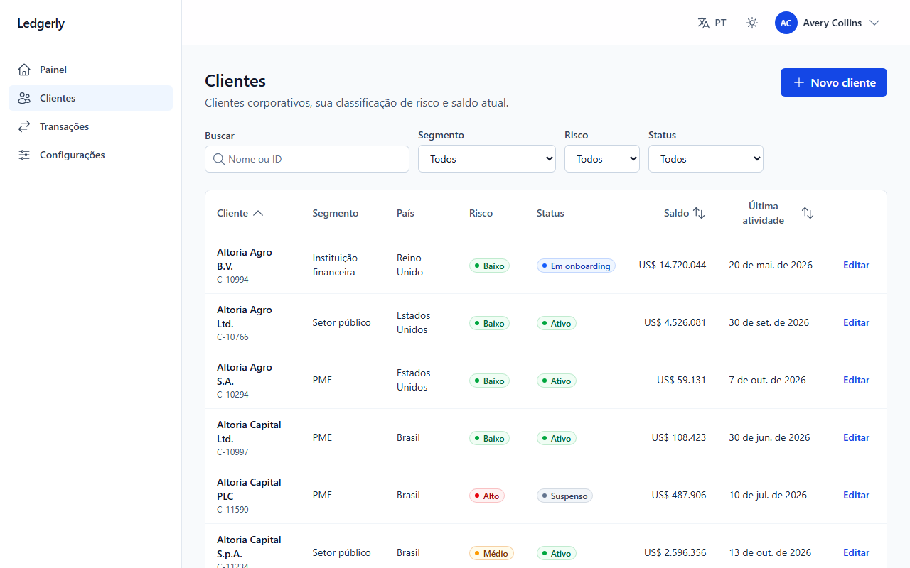

# Ledgerly — Angular enterprise showcase

[](https://github.com/iverson-viana/angular-enterprise-showcase/actions/workflows/ci.yml)


-blue>)


A B2B banking dashboard built to show how I structure a production-grade Angular app:
signals end to end, zoneless change detection, typed Signal Forms, runtime i18n,
accessibility verified in CI, and a test pyramid that gates every deploy.

**Live demo → [ledgerly-eda.pages.dev](https://ledgerly-eda.pages.dev)** · sign in with a demo role on the login page.



> Everything here is fictional: company names, people, IBANs and tax IDs are invented or
> standard documentation samples. The API is mocked inside the page, so the demo needs no backend.

## Highlights

- **Angular 22, the modern way** — standalone components, zoneless, OnPush by default, signals
  for state (`computed`, `linkedSignal`, `httpResource`), new control flow and `@defer`.
- **Real-world features** — JWT auth with silent refresh, role-based access, a dashboard with an
  accessible hand-built chart, a server-paginated table with URL state, a 10,000-row virtualized
  infinite feed, and a create/edit form with masks, checksums and async validation.
- **Accessibility as a requirement** — keyboard support everywhere, focus management, live
  regions, `axe` (WCAG 2.2 AA) run by Playwright in light and dark mode on every push.
- **Tested and gated** — 161 unit/component tests (90% statement coverage, thresholds enforced)
  and 21 end-to-end tests; lint → unit → build → e2e must pass before a deploy.
- **EN / PT-BR at runtime** — typed message keys checked at compile time, locale-aware numbers,
  dates and currency, switch without reloading.

## Screenshots

| Dashboard                                                                             | Dark mode                                                                            |
| ------------------------------------------------------------------------------------- | ------------------------------------------------------------------------------------ |
|  |                        |
| **Customers — filters, sorting and paging in the URL**                                | **Onboarding form — focused error summary**                                          |
|               |  |
| **Virtualized transactions feed**                                                     | **Português (Brasil)**                                                               |
|              |       |

Screenshots and the GIF are generated from the running app by Playwright (`npm run docs:media`).

## Demo accounts

| Role    | Email                  | Can                                                  |
| ------- | ---------------------- | ---------------------------------------------------- |
| Admin   | `admin@ledgerly.dev`   | everything, including creating and editing customers |
| Analyst | `analyst@ledgerly.dev` | dashboard, customers (read-only), transactions       |
| Viewer  | `viewer@ledgerly.dev`  | dashboard and transactions                           |

Password for all: `Ledgerly#2026` (the login page fills it in for you).

## Stack

| Area      | Choice                                                                           |
| --------- | -------------------------------------------------------------------------------- |
| Framework | Angular 22 (standalone, zoneless, signals), TypeScript 6 strict                  |
| UI        | Tailwind CSS v4, Angular CDK (menu, virtual scroll), hand-built SVG chart        |
| Forms     | Signal Forms (`@angular/forms/signals`) with schema validation                   |
| Data      | `HttpClient` + `httpResource`, functional interceptors                           |
| Mock API  | MSW handlers served in-page via `@mswjs/interceptors`                            |
| Tests     | Vitest + jsdom (unit/component), Playwright + `@axe-core/playwright` (e2e, a11y) |
| Quality   | ESLint (angular-eslint), Prettier, Husky + lint-staged, Commitlint               |
| CI/CD     | GitHub Actions → Cloudflare Pages (production on `main`, previews on PRs)        |

## Architecture decisions

**Why signals, zoneless and OnPush everywhere.** Change detection runs only where a signal a
template reads has changed. There is no Zone.js patching of browser APIs, no
`ChangeDetectorRef` plumbing, and derived state is declared once with `computed()` instead of
being kept in sync by hand. It is also where Angular is heading, so the code reads like new
Angular code should.

**Why standalone components.** Each component declares exactly what its template uses, so
dependencies are explicit, lazy loading is per route (`loadComponent`) and there is no
`NgModule` layer to maintain. Create and edit customer share one lazy chunk.

**State strategy — the smallest tool that fits.**

- _Server state_ lives in `httpResource`. `linkedSignal` keeps the last page on screen (dimmed)
  while the next one loads, so there is no skeleton flash on every filter change.
- _List state_ (filters, sort, page, dashboard period) lives in the **URL**, so it is shareable,
  bookmarkable and survives reload and Back. The page and the mock API share one parser, so
  defaults are dropped from the URL and invalid params fall back safely.
- _Feature state_ that needs coordination — the infinite transactions feed with cursor
  pagination and request cancellation — is a small signal store provided by the page, so it is
  scoped to it. A global store such as NgRx would add ceremony without solving anything here.
- _App-wide state_ (session, theme, language, toasts) lives in root `@Service()`s that expose
  read-only signals.

**Auth.** The access token lives in memory only. The refresh token is persisted so a reload
restores the session. One interceptor attaches the token, refreshes once on a `401` (concurrent
requests share that refresh) and replays the request. A failed refresh signs the user out and
says why. Route guards mirror the API's role checks, and the mock API enforces them too.

**Mock API inside the page, not in a Service Worker.** MSW's `setupWorker` silently stops
mocking when the browser terminates the idle worker, which showed up as random failures after
navigating. The handlers run through `@mswjs/interceptors`' fetch interceptor instead (this
requires `withFetch()`). The same build is deployed as the demo and tested end to end.

**Forms.** Signal Forms with the rules in a separate, unit-tested schema:

- validators that depend on the selected country (CNPJ — including the 2026 alphanumeric
  format — NIPC, VAT ID, EIN);
- IBAN mod-97 and ABA routing checksums;
- cross-field rules (credit limit ≤ 3× volume) and a tree validator for duplicate emails;
- a debounced async name check, skipped for the saved name when editing.

Server conflicts (`409`) are mapped back onto the field that caused them. Masked inputs are
custom `FormValueControl`s: the model stores the clean value and the caret stays in place while
the display reformats.

**Runtime i18n instead of `@angular/localize`.** Compile-time localization produces one build per
language, and switching languages means loading another URL. For a demo with a language switch,
runtime translation is the better trade-off:

- English is the source dictionary and defines a `MessageKey` type. A missing translation, or a
  typo in a template, fails the build.
- A test checks that every Portuguese string keeps the same `{placeholders}`.
- The active locale is a signal that formatters read, so every formatted number and date
  re-renders on a switch with no reload.
- Portuguese ships as a separate 3 kB chunk.

**Accessibility.**

- Skip link, and focus moves to the main content on navigation.
- The mobile navigation is a native `<dialog>`.
- Two toast live regions exist from page load: errors are assertive and never auto-dismiss;
  other toasts pause while hovered or focused.
- The chart is keyboard-readable and has a data-table view.
- The virtualized feed uses ARIA table roles with `aria-rowcount`/`aria-rowindex`, so screen
  readers announce the real position in all 10,000 rows.
- Error summaries take focus, and accessible names include their visible labels.
- `axe` runs in CI on the main pages, in both themes, and on a form showing errors.

## AI-assisted workflow

I used an AI coding assistant (Claude Code) as a pair programmer on this project. The
project rules it follows are versioned in [`CLAUDE.md`](CLAUDE.md): the stack, Angular
conventions and the accessibility bar. I made the architecture decisions above, reviewed every
change, and the same gates apply to everything that lands: format, lint, unit tests with
coverage thresholds, a production build, and Playwright + axe end to end, all in CI before any
deploy.

## Getting started

Requirements: Node 26 (see `.nvmrc`) and npm.

```bash
npm ci
npm start            # http://localhost:4200
```

## Scripts

| Script                            | What it does                                                   |
| --------------------------------- | -------------------------------------------------------------- |
| `npm start`                       | Dev server with the in-page mock API                           |
| `npm run build`                   | Production build (`dist/`)                                     |
| `npm test`                        | Unit/component tests in watch mode                             |
| `npm run test:coverage`           | Unit tests once, with coverage report and enforced thresholds  |
| `npm run e2e`                     | Playwright end-to-end + axe suite against the production build |
| `npm run e2e:ui`                  | Playwright UI mode                                             |
| `npm run lint` / `npm run format` | ESLint / Prettier                                              |
| `npm run docs:media`              | Regenerates the README screenshots and GIF                     |

First e2e run: `npx playwright install chromium`.

## Testing

| Layer            | Tooling                                            | Scope                                                                                          |
| ---------------- | -------------------------------------------------- | ---------------------------------------------------------------------------------------------- |
| Unit & component | Vitest + jsdom, `TestBed`, `HttpTestingController` | 161 tests: services, interceptors, guards, validators, schemas, components through the DOM     |
| End-to-end       | Playwright (Chromium)                              | 21 tests: auth and roles, URL state, onboarding create/edit, infinite scroll, i18n, mobile nav |
| Accessibility    | `@axe-core/playwright`                             | WCAG 2.2 A/AA rules on key pages, light and dark                                               |

Unit coverage: **90% statements · 84% branches · 88% functions · 91% lines.** CI fails below
88 / 80 / 85 / 88. The e2e suite also runs the production build, the same artifact that is deployed.

### Lighthouse (live demo, login page)

|         | Performance | Accessibility | Best practices | SEO |
| ------- | ----------- | ------------- | -------------- | --- |
| Desktop | 100         | 100           | 100            | 100 |
| Mobile  | ~90         | 100           | 100            | 100 |

Mobile performance is bounded by the demo setup: the in-page mock API (MSW and the fixture
generators, ~68 kB gzipped) must be installed before Angular boots, which adds a round trip on
a throttled connection. Loading it in parallel or inlining it into the main bundle was measured
and made the largest contentful paint worse, so it stays a separate chunk. A real backend
removes that cost entirely.

## CI/CD

```
push / PR ──► verify: format → lint → unit tests (+coverage gate) → build
                └──► e2e: Playwright + axe on that build
                       └──► deploy: Cloudflare Pages (main → production, PR → preview)
```

The deploy job ships the exact build artifact that passed the checks; nothing is rebuilt.

## Project structure

```
src/app/
  core/        auth, http interceptors, i18n, notifications, error handling, theme, guards
  shared/      UI (icon, badge, paginator), form controls (masked/amount inputs), formatting, validators
  features/    dashboard · customers (list + create/edit form) · transactions · settings · errors
  layout/      shell, sidebar, top bar
src/mocks/     MSW handlers + deterministic, invented fixtures (seeded PRNG)
e2e/           Playwright specs, fixtures and the README media capture
```
